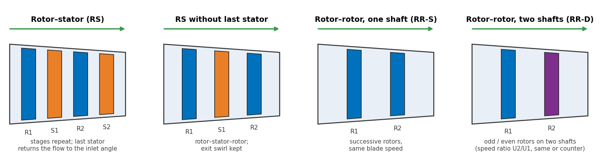

# CDA Compressor

**Mean-line preliminary design and off-design analysis of axial compressors**: rotor–stator (with or without the last stator), rotor–rotor on one shaft and rotor–rotor on two shafts.

<!-- replace XXXXXXX with the concept DOI that Zenodo gives the repository -->

CDA Compressor contains two linked MATLAB apps and a launcher:

| App | What it does |
|---|---|
| **Design app** | Sweeps the flow coefficient, loading coefficient, reaction (and speed ratio) for 1–12 stages or rotors; feasibility limits (solidity, Mach number, de Haller, hub/tip, h/c, exit swirl); four interactive design maps; selection by objective or by clicking a map; row-by-row design (velocity triangles, losses, NACA-65 metal angles, annulus, blade numbers); comparison of designs; export of the design file. |
| **Off-design app** | Reads the design file and computes the complete map (15 speed lines, 50–120 % speed): choke, peak pressure ratio, Howell stall onset, first stability limit, stall and choke margins, usable range, Greitzer B (surge or rotating stall), Koch stage-loading indicator; non-dimensional, relative and corrected maps with fitted boundary lines; validation against measured maps; correlation settings for sensitivity studies; PDF/Excel/PNG reports. |

The method and its validation against NACA measured compressor maps are described in the paper below.

## Install

Choose one of the three ways (files under **Releases** on the right of this page):

1. **Windows program (no MATLAB needed)** – download `CDA_Compressor_Installer.exe` and run it. The installer also installs the free MATLAB Runtime R2025b (internet needed the first time). Start *CDA Compressor* from the Start menu.
2. **MATLAB toolbox** – download `CDA_Compressor_v1.0.0.mltbx` and double-click it in MATLAB. Start it from the APPS tab or by typing `CDA_launcher`.
3. **From the source** – download the repository, add the `src` folder to the MATLAB path and run `CDA_launcher`.

**Requirements (2, 3):** MATLAB R2020a or later (developed and tested in R2025b). No toolbox is required; the Optimization Toolbox is used only by the optional "iterative" inlet-velocity setting.

> If the Windows program reports *"Could not find version 25.2 of the MATLAB Runtime"*, add
> `C:\Program Files\MATLAB\MATLAB Runtime\R2025b\runtime\win64` to your **user** Path
> (Start → "Edit environment variables for your account" → Path → New), then sign out and in.

## Quick start

1. Run `CDA_launcher`, choose a configuration and press **Open the design app**.
2. Press **Default inputs**, then **Compute the design space**, pick a point (*Find the best point* or click a map), press **Use this point**.
3. Press **Send to the off-design app**, then **Run** in the off-design app.
4. Or open one of the files in `examples/` directly in the off-design app.

Both apps have an illustrated guide (buttons in the launcher; `src/cda_guide.html`, `src/cda_offdesign_guide.html`).

## Examples

| Folder | Content |
|---|---|
| `examples/` | Design files of the eight two-row designs of the paper (four configurations × maximum efficiency / maximum pressure ratio). |
| `examples/validation/` | The NACA stage (RM E50A09/E50D26) and rotor (RM E57I03) validation cases, levels A and B, with the measured maps. |

## How to cite

If you use CDA Compressor, please cite the software (button **"Cite this repository"** on the right, or the Zenodo DOI) and the paper:

> Hassan AMA, Hemid AAA, Abdelhamid TST, Elshebiny DN (2026) Preliminary design and off-design performance of rotor–stator and rotor–rotor axial compressor configurations. *Journal, volume, pages.* https://doi.org/xx.xxxx/xxxxx  *(to be completed after publication)*

## Authors

Ahmed Mohamed Ahmed Hassan, Abdalmoez Ahmed Abdullah Hemid, Thabet Saber Thabet Abdelhamid, Deyaa ElHaq Nabil Elshebiny – Department of Aerospace Engineering, Faculty of Engineering, Cairo University, Giza, Egypt.

## License

MIT License – see [LICENSE](LICENSE). The MATLAB Runtime is distributed by MathWorks under its own license.
